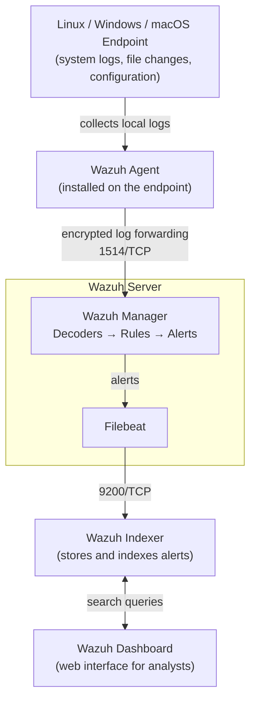
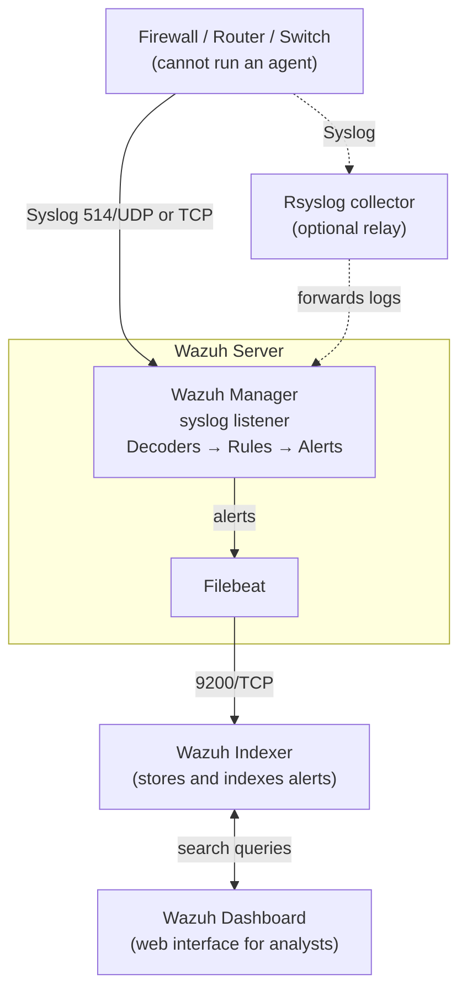

# SOC Analyst Level 01 -- Class 01

## Introduction to Security Operations Center (SOC)

**Study Notes \| Beginner Level**

------------------------------------------------------------------------

## 1. What is SOC?

**SOC stands for Security Operations Center.**

A Security Operations Center (SOC) is a centralized team responsible for
monitoring, detecting, analyzing, and responding to cybersecurity
threats and security incidents within an organization.

### Main objectives of a SOC

-   Protect organizational IT infrastructure.
-   Monitor security events 24/7.
-   Detect suspicious activities and cyberattacks.
-   Analyze security alerts.
-   Respond to security incidents.
-   Reduce cybersecurity risks.

### Three core components of a SOC

#### 1. People

Security professionals who monitor, investigate, and respond to security
incidents.

#### 2. Process & Policy

Documented procedures, rules, guidelines, and workflows that define how
security operations are performed.

#### 3. Technology

Security tools and technologies used for monitoring, detection,
investigation, and response.

------------------------------------------------------------------------

## 2. Core Functions of a SOC

  -----------------------------------------------------------------------
  Function                            Description
  ----------------------------------- -----------------------------------
  24/7 Monitoring                     Continuously monitoring systems and
                                      networks.

  Threat Detection                    Identifying malicious or suspicious
                                      activities.

  Alert Analysis                      Investigating security alerts to
                                      determine their severity.

  Incident Response                   Taking action to contain and
                                      resolve security incidents.

  Threat Hunting                      Proactively searching for hidden
                                      threats.

  Security Reporting                  Preparing security reports and
                                      communicating findings.
  -----------------------------------------------------------------------

------------------------------------------------------------------------

## 3. How Does a SOC Work?

A SOC follows a continuous security operations cycle:

1.  **Detect:** Identify suspicious activities and security events.
2.  **Analyze:** Investigate logs, alerts, and potential threats.
3.  **Respond:** Contain threats and take appropriate actions.
4.  **Report:** Document findings and communicate results.

------------------------------------------------------------------------

## 4. Security Monitoring and Endpoints

An **endpoint** is a device connected to an organization's network that
can send or receive data.

### Examples of endpoints and infrastructure

-   Desktop computers
-   Laptops
-   Servers
-   Firewalls
-   Routers
-   Network switches

### What is a log?

A **log** is a record of activities or events generated by a system,
application, or network device.

Example:

``` text
Device: Linux Server
Event: SSH Login Failed
Source IP: 10.24.50.123
Username: admin
Status: Failed
Timestamp: 22:30:15
```

The SOC Analyst investigates whether this activity is normal or
suspicious.

------------------------------------------------------------------------

## 5. Understanding Security Events -- Practical Examples

### Example 1: Virus Detection

Scenario: A user downloads a malicious file, and Windows Defender
detects it.

``` text
Event: Malware Detected
Device: Desktop-01
Security Tool: Windows Defender
Threat: Trojan
Action: Quarantined
```

**SOC Analyst responsibilities:**

1.  Review the malware detection alert.
2.  Identify the affected endpoint.
3.  Check the malware name and severity.
4.  Verify whether the threat was quarantined.
5.  Investigate related activities.
6.  Escalate the incident if necessary.

### Example 2: Multiple Failed SSH Login Attempts

Scenario: An attacker attempts to access a Linux server using SSH.

Suppose the server generates five failed login events within a short
period.

``` text
Event: SSH Authentication Failed
Source IP: 10.24.50.123
Username: root
Failed Attempts: 5
Destination: Linux Server
Port: 22
```

A SOC may identify repeated failed login attempts as suspicious.

**Illustrative detection thresholds:**

-   5 failed login attempts: Generate a warning.
-   50 failed login attempts: Generate a high-priority alert.

These are examples only. Actual thresholds depend on organizational
policy and detection engineering.

This activity may indicate a **brute-force attack**.

### Example 3: Firewall Log Analysis

A firewall records network traffic entering and leaving an organization.

``` text
Device: Firewall
Source IP: 10.24.50.123
Destination IP: 10.24.17.112
Protocol: TCP
Destination Port: 22
Action: Deny
Event: Connection Blocked
```

**SOC Analyst responsibilities:**

-   Identify the source and destination IP addresses.
-   Understand which port was accessed.
-   Check whether the firewall allowed or blocked the traffic.
-   Investigate suspicious connection attempts.

------------------------------------------------------------------------

## 6. Log Collection and Log Parsing

### What is Log Collection?

Log collection is the process of gathering event data from different
endpoints, servers, applications, and network devices into a centralized
security monitoring platform.

Examples of log sources:

-   Windows Event Logs
-   Linux System Logs
-   Firewall Logs
-   Antivirus Logs
-   Web Server Logs
-   Network Device Logs

### What is Log Parsing?

**Log parsing** is the process of extracting meaningful information from
raw log data and converting it into structured fields.

Raw log:

``` text
Failed password for root from 10.24.50.123 port 45678 ssh2
```

Parsed log:

  Field         Value
  ------------- ---------------------------
  Event Type    SSH Authentication Failed
  Username      root
  Source IP     10.24.50.123
  Source Port   45678
  Protocol      SSH

### Why is log parsing important?

-   Makes logs easier to understand.
-   Helps identify suspicious activities.
-   Supports correlation and detection rules.
-   Improves security investigations.
-   Enables effective SIEM monitoring.

------------------------------------------------------------------------

## 7. Log Collection Methods

There are two common log collection approaches.

### A. Agent-Based Log Collection

An **agent** is a software component installed on an endpoint or server
to collect and forward logs to a centralized monitoring platform.

Examples:

-   Wazuh Agent
-   Elastic Agent
-   Splunk Universal Forwarder

**Advantages:**

-   Collects detailed endpoint information.
-   Supports File Integrity Monitoring.
-   Can monitor system configurations.
-   Provides endpoint-level visibility.

### B. Agentless Log Collection

Agentless collection gathers logs or monitoring information without
installing a dedicated monitoring agent on the target device.

Common methods:

  -----------------------------------------------------------------------
  Method                              Description
  ----------------------------------- -----------------------------------
  SSH                                 Remotely accesses Linux systems to
                                      retrieve information or logs.

  Syslog                              Transfers log messages from network
                                      devices and servers.

  Rsyslog                             Provides log collection,
                                      processing, and forwarding.

  SNMP                                Collects network device monitoring
                                      information.
  -----------------------------------------------------------------------

**Example:** A firewall sends its security logs to a centralized SIEM
server using Syslog.

### Agent-based architecture



How to read it:

1.  The **Wazuh Agent** collects logs and security data on the endpoint.
2.  The agent sends the data to the **Wazuh Manager** over an encrypted
    connection (port 1514/TCP). Agents register with the manager first
    using port 1515/TCP.
3.  The **manager** decodes each log, checks it against rules and creates
    an alert when a rule matches.
4.  **Filebeat** (running on the Wazuh server) ships the alerts to the
    **Wazuh Indexer** for storage.
5.  The **Wazuh Dashboard** does not receive logs. It searches the
    indexer and shows the results to the analyst.

### Agentless architecture



How to read it:

1.  The network device sends its logs with **Syslog**, either directly to
    the Wazuh Manager or through an **Rsyslog** collector that relays them.
2.  From the manager onward, the flow is the same as agent-based
    collection: decoders, rules, alerts, indexer and dashboard.

Other agentless methods from the table above:

-   **SSH:** Wazuh's *agentless monitoring* feature lets the manager log
    in to a device over SSH to check files and command output for changes.
-   **SNMP:** Wazuh does not poll SNMP itself. SNMP is usually handled by
    network monitoring tools (for example Zabbix or PRTG), which can
    forward their events to the SIEM as Syslog.

------------------------------------------------------------------------

## 8. File Integrity Monitoring (FIM)

**FIM stands for File Integrity Monitoring.**

FIM is a security mechanism that monitors important files and
directories to detect unauthorized changes.

It can detect:

-   File creation
-   File modification
-   File deletion
-   Permission changes
-   Ownership changes

### Important Linux directories to monitor

  -----------------------------------------------------------------------
  Directory                           Purpose
  ----------------------------------- -----------------------------------
  `/var/www/html/`                    Web server document root; often
                                      contains website files.

  `/etc/`                             Linux system configuration files.

  `/home/`                            User home directories and personal
                                      files.
  -----------------------------------------------------------------------

### Practical example

Suppose an attacker modifies the website's `index.php` file.

``` text
File: /var/www/html/index.php
Event: File Modified
Status: Change Detected
```

The SIEM generates an alert, and the SOC Analyst investigates whether
the change was authorized.

### Why is FIM important?

-   Detects unauthorized file modifications.
-   Helps identify website defacement.
-   Detects suspicious configuration changes.
-   Supports compliance and security auditing.

------------------------------------------------------------------------

## 9. SOC Team Structure -- People

A SOC requires different levels of security professionals.

### SOC Analyst Level 1 (L1)

L1 analysts are generally responsible for initial monitoring and alert
triage.

Responsibilities:

-   Monitor security alerts.
-   Perform initial investigation.
-   Validate security events.
-   Identify false positives.
-   Escalate suspicious incidents to L2.

### SOC Analyst Level 2 (L2)

L2 analysts perform deeper investigations.

Responsibilities:

-   Investigate escalated alerts.
-   Analyze correlated events.
-   Determine incident scope and impact.
-   Support containment and remediation.
-   Escalate complex incidents to L3.

### SOC Analyst Level 3 (L3)

L3 analysts handle advanced investigations and complex security
incidents.

Responsibilities:

-   Perform advanced threat analysis.
-   Investigate sophisticated attacks.
-   Lead complex incident response.
-   Conduct threat hunting.
-   Improve detection capabilities.

### SOC Manager

The SOC Manager leads the SOC team and oversees operations.

Responsibilities:

-   Manage the SOC team.
-   Define operational processes and policies.
-   Monitor SOC performance.
-   Coordinate incident escalation.
-   Communicate security risks to management.

**Note:** L1, L2, and L3 are responsibility levels, not fixed experience
requirements. Required years of experience vary between organizations.

### Other important SOC role: SIEM Engineer

A SIEM Engineer is responsible for:

-   SIEM deployment and administration.
-   Log source integration.
-   Log parsing and normalization.
-   Detection rule development.
-   SIEM architecture and performance.
-   Troubleshooting log collection issues.

------------------------------------------------------------------------

## 10. Process & Policy in SOC

### What is a Process?

A process defines the steps that security professionals must follow to
complete a particular task.

Example: Incident Response Process

1.  Alert received.
2.  Initial investigation.
3.  Incident validation.
4.  Incident classification.
5.  Escalation.
6.  Containment and remediation.
7.  Documentation and closure.

### What is a Security Policy?

A security policy is a formal document that defines an organization's
security rules, requirements, and responsibilities.

Examples:

-   Password Policy
-   Access Control Policy
-   Incident Response Policy
-   Acceptable Use Policy
-   Log Retention Policy
-   Vulnerability Management Policy

### Difference between Process and Policy

  -----------------------------------------------------------------------
  Process                             Policy
  ----------------------------------- -----------------------------------
  Defines how to perform a task.      Defines security requirements and
                                      rules.

  Contains step-by-step activities.   Contains formal organizational
                                      guidelines.

  Example: Incident investigation     Example: Incident Response Policy.
  workflow.                           
  -----------------------------------------------------------------------

------------------------------------------------------------------------

## 11. Technology Used in SOC

  Category                   Examples
  -------------------------- ----------------------------------------------
  SIEM                       Wazuh, Splunk, Microsoft Sentinel
  EDR                        Microsoft Defender for Endpoint, CrowdStrike
  Firewall                   Fortinet, Palo Alto
  IDS/IPS                    Suricata, Snort
  Vulnerability Management   Nessus, Tenable
  Network Monitoring         Zabbix, PRTG
  Threat Intelligence        MISP, VirusTotal
  Case Management            TheHive, Jira

------------------------------------------------------------------------

## 12. Important SOC Terminology

  -----------------------------------------------------------------------
  Term                                Full Form / Meaning
  ----------------------------------- -----------------------------------
  SOC                                 Security Operations Center

  SIEM                                Security Information and Event
                                      Management

  EDR                                 Endpoint Detection and Response

  IDS                                 Intrusion Detection System

  IPS                                 Intrusion Prevention System

  FIM                                 File Integrity Monitoring

  IOC                                 Indicator of Compromise

  TTP                                 Tactics, Techniques, and Procedures

  IR                                  Incident Response

  EPS                                 Events Per Second

  IP                                  Internet Protocol

  SSH                                 Secure Shell

  Syslog                              Standard for transmitting log
                                      messages

  MITRE ATT&CK                        Framework for understanding
                                      adversary tactics and techniques
  -----------------------------------------------------------------------

------------------------------------------------------------------------

## 13. Class 01 -- Key Learning Points

After completing this class, you should be able to:

1.  Explain what a SOC is.
2.  Identify the three core components of a SOC.
3.  Explain the major functions of a SOC.
4.  Understand endpoints and log sources.
5.  Understand log collection and log parsing.
6.  Differentiate agent-based and agentless log collection.
7.  Explain File Integrity Monitoring.
8.  Understand SOC team structure and responsibilities.
9.  Differentiate security processes and policies.
10. Identify common SOC technologies.

------------------------------------------------------------------------

## 14. Practical Exercises

### Exercise 01: SOC Fundamentals

1.  What does SOC stand for?
2.  What are the three core components of a SOC?
3.  Why does a SOC need 24/7 monitoring?
4.  What is the difference between threat detection and threat hunting?

### Exercise 02: Log Analysis

Analyze the following event:

``` text
Event: Failed SSH Login
Source IP: 10.24.50.123
Username: root
Destination Port: 22
Failed Attempts: 50
```

Answer these questions:

1.  What type of activity is this?
2.  What is the source IP?
3.  Which protocol is being used?
4.  What could be the possible attack?
5.  What should the SOC Analyst investigate?

### Exercise 03: Log Collection

1.  What is an agent?
2.  What is agentless log collection?
3.  What is Syslog?
4.  What is the difference between SSH and SNMP?
5.  Why is log parsing important?

### Exercise 04: FIM

1.  What does FIM stand for?
2.  Why should `/etc/` be monitored?
3.  Why should `/var/www/html/` be monitored?
4.  What happens when an unauthorized file modification occurs?

------------------------------------------------------------------------

## 15. Interview Preparation -- Class 01

Practice answering these questions in English.

1.  What is a Security Operations Center?
2.  What are the primary responsibilities of a SOC Analyst?
3.  Explain the SOC monitoring and incident response lifecycle.
4.  What is the difference between a security event and a security
    incident?
5.  What is the difference between agent-based and agentless log
    collection?
6.  What is log parsing?
7.  What is File Integrity Monitoring?
8.  What are the responsibilities of SOC L1, L2, and L3?
9.  What is the role of a SIEM Engineer?
10. Why are People, Process, and Technology important in a SOC?

------------------------------------------------------------------------

## 16. English Speaking Practice

Learn these sentences and practice speaking them aloud.

**Sentence 01**

"A Security Operations Center is responsible for monitoring, detecting,
analyzing, and responding to cybersecurity threats."

**Sentence 02**

"As a SOC Analyst, my responsibility is to monitor security alerts,
investigate suspicious activities, and escalate security incidents."

**Sentence 03**

"Log collection is the process of gathering security events from
different endpoints, servers, and network devices."

**Sentence 04**

"File Integrity Monitoring helps detect unauthorized changes to critical
files and directories."

**Sentence 05**

"A SIEM Engineer is responsible for log integration, parsing,
normalization, detection engineering, and SIEM administration."

------------------------------------------------------------------------

## 17. Class 01 Progress Checklist

-   [ ] Read all study notes.
-   [ ] Understand People, Process & Technology.
-   [ ] Practice log analysis examples.
-   [ ] Understand Agent vs. Agentless.
-   [ ] Understand FIM.
-   [ ] Answer the 15 interview questions.
-   [ ] Practice English speaking.

------------------------------------------------------------------------

## 18. Additional Interview Questions -- Class 01

### Basic Questions

1.  What is the difference between a SOC and a NOC?
2.  Name the three core components of a SOC and briefly explain each one.

### Scenario-Based Questions

3.  A SIEM alert shows 50 failed SSH logins from a single IP address
    within 2 minutes. As an L1 analyst, what are your first steps?
4.  An employee reports that a file in `/etc/` was modified without
    approval. How would you use File Integrity Monitoring to investigate?
5.  A critical server stops sending logs to the SIEM. How would you
    troubleshoot whether the issue is the agent, the network, or the SIEM
    itself?

------------------------------------------------------------------------

## Recommended Next Class

**Class 02: Understanding Cybersecurity Fundamentals**

Topics:

-   Threats
-   Vulnerabilities
-   Risks
-   Cyberattacks
-   Security Events
-   Security Incidents

------------------------------------------------------------------------

**Learning advice:** Do not just memorize definitions. Understand how a
real SOC works using practical examples from Windows Defender, Linux SSH
logs, firewalls, and Wazuh.
