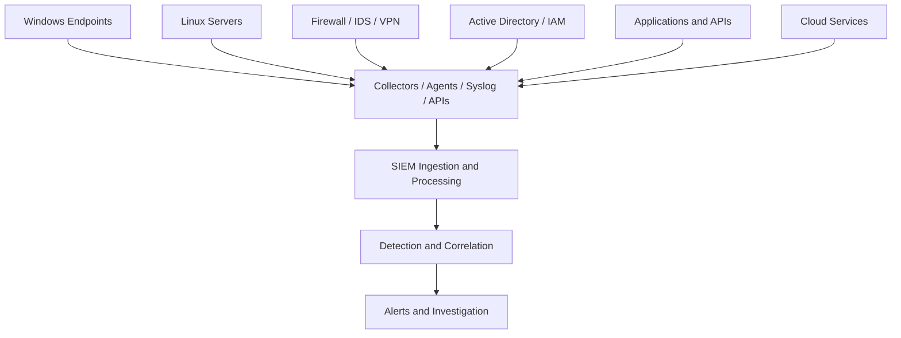
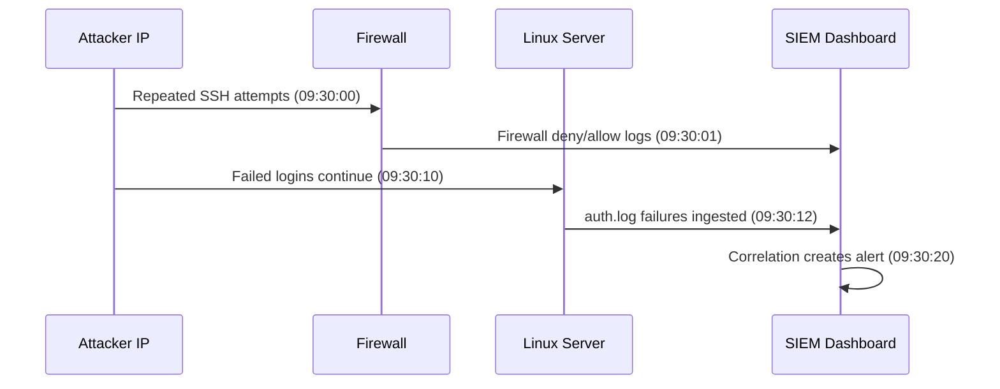
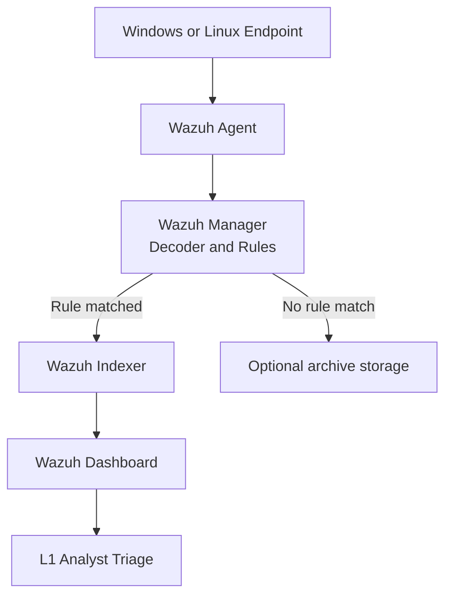

# SOC Analyst - Class 03
## Log Fundamentals, Event Sources, Log Formats, Timestamps, Severity Levels and Windows/Linux Logs

**Course:** SOC Analyst - Level 01  
**Class:** 03  
**Topic:** Log Fundamentals for SOC Monitoring and Investigation

---

## 1. Why Logs Matter in a SOC

Logs are the foundation of security monitoring and incident investigation.

Without logs, SOC analysts cannot reliably answer key questions such as:

- What happened?
- When did it happen?
- Who or what initiated the action?
- Which systems were affected?
- Is this normal behavior or suspicious activity?

In real SOC operations, good visibility depends on collecting the right logs, storing them correctly, and understanding how to investigate them.

---

## 2. Log vs Event

These terms are related, but not identical.

### 2.1 What is an event?

An **event** is an observable action in a system.

Examples:

- A user logs in.
- A process starts.
- A firewall blocks a connection.
- A service stops unexpectedly.

### 2.2 What is a log?

A **log** is a recorded representation of one or more events.

Examples:

- Windows Event Viewer entries
- Linux authentication logs
- Firewall traffic logs
- Application access logs

### 2.3 Simple relationship

- Event = action that happened.
- Log = record of that action.

---

## 3. Core Elements of a Log Entry

Most useful log entries contain these fields:

| Field | Meaning |
|---|---|
| Timestamp | When the event occurred |
| Hostname / Device | Which system generated the log |
| Source IP | Origin of activity |
| Destination IP | Target system or service |
| Username / Account | Identity involved |
| Process / Service | Program or service tied to the event |
| Event ID / Code | Product-specific identifier |
| Severity / Level | Importance or urgency |
| Message | Human-readable description |

Not every source includes all fields. One SOC challenge is normalizing different log schemas into a common structure.

---

## 4. Common Log Categories

SOC analysts usually work across multiple log categories.

### 4.1 Authentication and identity logs

- Login success/failure
- MFA events
- Account lockouts
- Privilege changes

### 4.2 Endpoint and host logs

- Process creation
- Service changes
- File access/modification
- USB or removable media actions

### 4.3 Network logs

- Firewall allow/deny traffic
- VPN connections
- IDS/IPS alerts
- DNS query activity

### 4.4 Application logs

- Web server requests
- API usage
- Application errors
- Admin action logs

### 4.5 Cloud logs

- Console logins
- IAM policy changes
- Resource creation/deletion
- Suspicious API activity

---

## 5. Log Sources in SOC Architecture

A mature SOC depends on broad telemetry coverage.



If one major source is missing, important attack evidence may be invisible.

---

## 6. Common Log Formats

Different systems emit different formats. Analysts must recognize them quickly.

### 6.1 Plain text format

```text
Failed password for invalid user admin from 203.0.113.42 port 51422 ssh2
```

### 6.2 Key-value format

```text
src_ip=203.0.113.42 dst_ip=10.10.20.15 action=deny protocol=tcp dst_port=22
```

### 6.3 JSON format

```json
{
	"timestamp": "2026-11-16T09:30:12Z",
	"host": "web-01",
	"event_type": "login_failure",
	"username": "admin",
	"source_ip": "203.0.113.42"
}
```

### 6.4 CSV format

```text
2026-11-16 09:30:12,web-01,login_failure,admin,203.0.113.42
```

### 6.5 Syslog-style format

```text
Nov 16 09:30:12 srv-auth sshd[2142]: Failed password for root from 203.0.113.42 port 51422 ssh2
```

SOC tools parse these raw formats into fields so analysts can search and correlate data.

---

## 7. Timestamp Fundamentals

Time is critical in investigations.

### 7.1 Why timestamp quality matters

- Incident timeline reconstruction
- Correlation across systems
- Root cause analysis
- Legal and audit reporting

### 7.2 Time format standards

Common formats:

- `2026-11-16 09:30:12` (local system format)
- `2026-11-16T09:30:12Z` (ISO 8601 UTC)
- `Nov 16 09:30:12` (syslog style, often without year)

### 7.3 Timezone and clock issues

Potential SOC problems:

- Sources in different time zones
- Daylight saving changes
- Incorrect system clocks
- Unsynchronized network devices

Best practice:

- Use NTP for time synchronization.
- Normalize events to UTC in SIEM.
- Preserve original timestamp for evidence.

### 7.4 Timeline example



---

## 8. Severity and Priority

Severity helps analysts decide what to investigate first.

### 8.1 General severity model

| Level | Typical meaning |
|---|---|
| Informational | Normal operational activity |
| Low | Minor issue or low-risk anomaly |
| Medium | Suspicious behavior requiring review |
| High | Likely malicious activity requiring fast response |
| Critical | High-impact threat or active incident |

### 8.2 Syslog severity reference

| Syslog Code | Name |
|---|---|
| 0 | Emergency |
| 1 | Alert |
| 2 | Critical |
| 3 | Error |
| 4 | Warning |
| 5 | Notice |
| 6 | Informational |
| 7 | Debug |

Severity alone is not enough. Analysts also need business context, asset criticality, and behavior pattern.

---

## 9. Windows Log Fundamentals

Windows systems generate rich event telemetry used heavily in SOC investigations.

### 9.1 Key Windows log channels

- Security
- System
- Application
- Microsoft-Windows-* operational channels (product-specific)

### 9.2 Common Windows security event IDs (intro level)

| Event ID | Description |
|---|---|
| 4624 | Successful logon |
| 4625 | Failed logon |
| 4634 | Logoff |
| 4672 | Special privileges assigned to new logon |
| 4688 | New process created |
| 4720 | User account created |
| 4726 | User account deleted |
| 4732 | Member added to local security-enabled group |

### 9.3 Example Windows event interpretation

If many `4625` failures are followed by a `4624` success from the same source, this may indicate brute-force success and requires immediate investigation.

---

## 10. Linux Log Fundamentals

Linux servers store valuable activity records for authentication, system services and kernel events.

### 10.1 Common Linux log locations

| Path | Typical content |
|---|---|
| /var/log/auth.log | Authentication and sudo activity (Debian/Ubuntu) |
| /var/log/secure | Authentication and sudo activity (RHEL/CentOS) |
| /var/log/syslog | General system messages (Debian/Ubuntu) |
| /var/log/messages | General system messages (RHEL/CentOS) |
| /var/log/kern.log | Kernel logs |
| /var/log/audit/audit.log | Detailed audit events when auditd is enabled |

### 10.2 Linux investigation examples

- Repeated SSH failures in auth logs
- Unexpected `sudo` privilege use
- New service startup after suspicious login
- Unusual command execution from cron or scripts

### 10.3 journald note

Many modern distributions use systemd journal (`journalctl`) as a primary log source. SIEM connectors often forward journald and traditional file logs together.

---

## 11. Parsing, Normalization and Enrichment

Raw logs are hard to analyze at scale. SOC tools transform them into searchable fields.

### 11.1 Parsing

Extracts fields from raw message text.

### 11.2 Normalization

Maps different source fields to common names.

Example:

- Source A uses `srcip`
- Source B uses `source_ip`
- SIEM normalized field becomes `source.ip`

### 11.3 Enrichment

Adds context such as:

- Asset owner and business criticality
- Geo-location of IP
- Threat intel match
- User department

These steps improve detection quality and reduce analyst confusion.

---

## 12. Practical Log-to-Alert Flow in Wazuh



Class 03 focus is understanding the quality of source logs before moving into advanced detection engineering.

---

## 13. Basic Analyst Checklist for Any Suspicious Log

When you see a suspicious event, verify:

1. Timestamp accuracy and timezone
2. Source and destination systems
3. User or account involved
4. Event type and severity
5. Related events before and after
6. Whether behavior is normal for that system/user
7. Whether similar events appear across multiple sources

This checklist prevents fast but incorrect conclusions.

---

## 14. Definitions (Class 03 Glossary)

| Term | Definition |
|---|---|
| Event | Observable action in a system |
| Log | Stored record of one or more events |
| Telemetry | Technical data emitted for monitoring and analysis |
| Timestamp | Date/time value attached to an event |
| Log Source | System or service that produces logs |
| Parsing | Extracting structured fields from raw logs |
| Normalization | Converting diverse fields into a consistent schema |
| Enrichment | Adding contextual information to events |
| Severity | Importance level of an event |
| Correlation | Linking multiple related events to identify patterns |
| Event ID | Numeric/code identifier for a specific log event type |
| Retention | How long logs are stored |
| NTP | Network Time Protocol for clock synchronization |

---

## 15. Class 03 Review Questions

1. What is the difference between an event and a log?
2. Why are logs essential in SOC operations?
3. Which fields are most important in a log entry?
4. What are common security log categories?
5. Why do different log formats create SOC challenges?
6. Why is timestamp consistency critical for investigations?
7. What issues happen when systems are not time-synchronized?
8. What is the difference between parsing and normalization?
9. What is enrichment and why is it useful?
10. Name three important Windows security event IDs and meanings.
11. Which Linux log files are commonly used for authentication investigations?
12. Why should severity not be used alone for incident decisions?
13. What should an analyst verify first when investigating a suspicious login event?
14. How do logs flow from endpoint to analyst in Wazuh?

---

## 16. Practical Homework

### Task 1 - Log Identification

Collect at least 10 sample logs from different categories (authentication, network, endpoint, application, cloud if available) and classify each by:

- Source
- Log type
- Format
- Severity

### Task 2 - Timestamp Practice

Create a mini incident timeline using at least 5 logs from two different systems.

Include:

- Original timestamp format
- Normalized UTC time
- Event sequence explanation

### Task 3 - Windows and Linux Mapping

Prepare a short table:

- 5 Windows Event IDs and what they indicate
- 5 Linux log entries and where they are commonly found

### Task 4 - SOC Notes Repository

Create or update a Markdown file in your SOC learning repository:

```text
classes/
	class-03.md
```

Add your class notes and practical homework evidence.

---

## 17. Study Note Examples (Worked)

Use these examples to practice reading logs like an L1 analyst.

### Example 1 - Linux SSH brute-force pattern

```text
Nov 16 09:30:10 srv-auth sshd[2142]: Failed password for invalid user admin from 203.0.113.42 port 51422 ssh2
Nov 16 09:30:13 srv-auth sshd[2143]: Failed password for invalid user root from 203.0.113.42 port 51425 ssh2
Nov 16 09:31:40 srv-auth sshd[2180]: Accepted password for opsuser from 203.0.113.42 port 51501 ssh2
```

How to read it:

- Same source IP repeatedly fails, then succeeds.
- Different usernames are attempted.
- This is high-priority suspicious activity and needs escalation.

### Example 2 - Windows failed and successful logon sequence

```text
EventID=4625 Time=2026-11-16T09:40:01Z AccountName=administrator IpAddress=198.51.100.27 LogonType=3
EventID=4625 Time=2026-11-16T09:40:08Z AccountName=administrator IpAddress=198.51.100.27 LogonType=3
EventID=4624 Time=2026-11-16T09:40:20Z AccountName=administrator IpAddress=198.51.100.27 LogonType=3
EventID=4672 Time=2026-11-16T09:40:21Z AccountName=administrator Privileges=SeDebugPrivilege,SeBackupPrivilege
```

How to read it:

- Multiple failures are followed by a success from same IP.
- Privileged token assignment appears right after login.
- Check if this source IP and login behavior are expected.

### Example 3 - Firewall deny burst on SSH

```text
time=2026-11-16T09:45:01Z device=fw-01 src_ip=203.0.113.42 dst_ip=10.10.20.15 dst_port=22 action=deny rule=outside-to-server
time=2026-11-16T09:45:03Z device=fw-01 src_ip=203.0.113.42 dst_ip=10.10.20.15 dst_port=22 action=deny rule=outside-to-server
time=2026-11-16T09:45:05Z device=fw-01 src_ip=203.0.113.42 dst_ip=10.10.20.15 dst_port=22 action=deny rule=outside-to-server
```

How to read it:

- Repeated denies show scanning or brute-force attempts.
- Even blocked traffic matters for threat visibility.
- Correlate with server auth logs to see if any attempt passed through another path.

### Example 4 - Timestamp normalization practice

Raw logs from different sources:

```text
Windows: 11/16/2026 03:50:20 PM (UTC+6)
Linux:   Nov 16 09:50:25 (UTC)
Firewall:2026-11-16T09:50:21Z
```

Normalized to UTC:

```text
Windows -> 2026-11-16T09:50:20Z
Linux   -> 2026-11-16T09:50:25Z
Firewall-> 2026-11-16T09:50:21Z
```

Why this matters:

- Normalization reveals true event order.
- Without timezone conversion, timeline analysis can be wrong.

### Example 5 - Quick analyst notes template

Use this mini template in your investigation notes:

```text
Alert: Repeated SSH login failures followed by success
Time window: 2026-11-16T09:30:10Z to 2026-11-16T09:31:40Z
Source IP: 203.0.113.42
Destination: srv-auth (10.10.20.15)
Usernames seen: admin, root, opsuser
Severity: High
Initial classification: Suspected true positive
Immediate actions: Escalate to L2, validate account owner, check follow-on commands
```

---

## 18. Class Summary

By the end of Class 03, students should understand:

- The difference between events and logs.
- Why log quality determines SOC visibility.
- Common log categories and source systems.
- How different log formats are parsed and normalized.
- Why timestamps, timezone handling and NTP are critical.
- How severity supports prioritization but requires context.
- Core Windows and Linux log sources for investigations.
- How logs move through a SIEM pipeline to analyst triage.

**Next class:** Basic SIEM Querying and Search - filtering events, field-based search, timeline pivots, and simple detection use cases.
